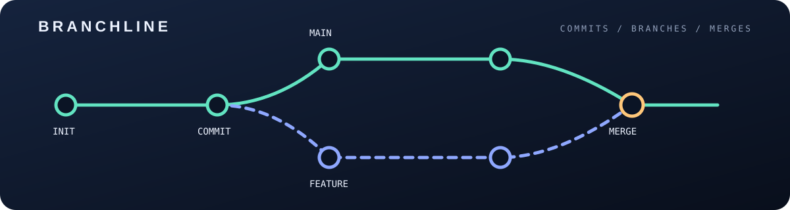

# Branchline

An interactive Git branching simulator for learning how commits and branches fit together. No Git installation required.

## Explore
- Create commits with custom messages.
- Create and switch branches.
- Merge another branch into the active branch.
- Inspect the evolving commit graph and command translation.
- Reset to the included demo at any time.

## Run
Open `index.html` in a modern browser. No installation, build step, or dependencies.

## Important
Branchline is an educational simulator. It does not run Git commands or modify local repositories. The simulated workspace lives only in the current page session.

## License
MIT